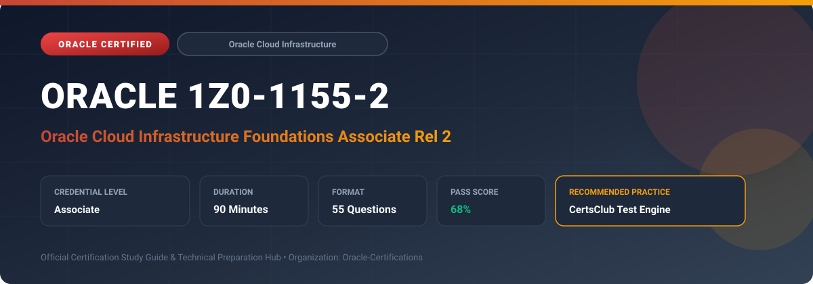

  

# Oracle 1Z0-1155-2: Oracle Cloud Infrastructure Foundations Associate Rel 2

---

## 1. Exam Overview & Candidate Profile

The **Oracle 1Z0-1155-2: Oracle Cloud Infrastructure Foundations Associate Rel 2** exam certifies foundational understanding of core cloud concepts and the fundamental architecture of Oracle Cloud Infrastructure.

Candidates validate knowledge across cloud concepts, OCI physical architecture (regions, availability domains, fault domains), compute, networking, storage, database services, security, pricing, and billing management.

### Target Audience & Prerequisites
- **Target Roles**: Implementation Specialists, Cloud Architects, Technical Leads, Enterprise Consultants, and Systems Engineers.
- **Recommended Experience**: 1–2 years of practical, hands-on experience designing, implementing, and maintaining corresponding Oracle solutions.
- **Credential Earned**: Associate Certification.

---

## 2. Key Exam Specifications

| Specification | Details |
| :--- | :--- |
| **Exam Code** | **Oracle 1Z0-1155-2** |
| **Official Title** | Oracle Cloud Infrastructure Foundations Associate Rel 2 |
| **Certification Track** | Oracle Cloud Infrastructure |
| **Exam Duration** | 90 Minutes |
| **Number of Questions** | 55 Questions |
| **Passing Score** | 68% |
| **Question Format** | Multiple Choice (Single/Multiple Answer), Scenario-Based Questions |
| **Delivery Provider** | Oracle University / Pearson VUE (Online Proctored or Test Center) |
| **Recommended Practice Engine** | [CertsClub Oracle Practice Tests](https://www.certsclub.com/oracle/1z0-1155-2-dumps.html) |

---

## 3. Official Blueprint & Exam Domain Breakdown

The examination assesses candidate competencies across core functional domains weighted as follows:

| Domain Area | Weighting |
| :--- | :--- |
| **Cloud Concepts & OCI Architecture (Regions, ADs, FDs)** | `30%` |
| **Core OCI Services (Compute, Networking, Storage)** | `30%` |
| **OCI Database Services & Autonomous Database** | `20%` |
| **Security, Identity & Governance Basics** | `10%` |
| **Billing, Cost Management, Pricing & Support** | `10%` |

---

## 4. Deep Dive into Complex & Challenging Technical Topics

To secure a passing score on the 1Z0-1155-2 exam, candidates must master the following advanced concepts:

- Understanding OCI global footprint: Regions, Availability Domains (AD), and Fault Domains (FD) for anti-affinity.
- Compute options: Bare Metal, Virtual Machines, Container Engine (OKE), and Functions (serverless).
- VCN core building blocks: Subnets, Route Tables, Security Lists, Internet Gateway, and NAT Gateway.
- Storage fundamentals: Block Volume, Object Storage (Standard/Archive), and File Storage Service (FSS).
- Cost management: Free Tier, Universal Credits, Cost Analysis, and Compartment-level budgets.

---

## 5. Scenario-Based Demo & Practice Questions

### Question 1
Within a single OCI Availability Domain, what architectural construct acts as a logical data center providing hardware anti-affinity to protect applications against power or hardware failures?

A) Fault Domain
B) Security List
C) Dynamic Routing Gateway
D) Compartment

- **Correct Answer**: `A) Fault Domain`  
- **Technical Explanation**: Each Availability Domain contains three Fault Domains. Distributing compute instances across Fault Domains prevents an application outage from single hardware or power rack failures.

---

### Question 2
Which OCI gateway enables compute instances in a private subnet to securely download software updates from the internet without exposing them to inbound internet connections?

A) Network Address Translation (NAT) Gateway
B) Internet Gateway
C) Local Peering Gateway
D) FastConnect Gateway

- **Correct Answer**: `A) Network Address Translation (NAT) Gateway`  
- **Technical Explanation**: A NAT Gateway allows instances in private subnets outbound access to the internet while completely blocking any inbound traffic initiated from the public internet.

---

## 6. Recommended Preparation Strategy & Practice Testing Engine

Achieving certification in **Oracle 1Z0-1155-2** requires balanced theoretical study and scenario-based simulation practice:

1. **Review Oracle Documentation**: Master architecture guides, implementation workbooks, and administration manuals on the Oracle Help Center.
2. **Hands-on Lab Practice**: Execute real-world configuration, policy setup, and troubleshooting tasks in your cloud tenancy or test instance.
3. **Simulated Exam Drills**: Practice answering timed, scenario-based multiple-choice questions to familiarize yourself with the question formats, traps, and timing constraints.

### Practice With CertsClub
For realistic practice questions, updated dumps, and mock testing environments:
- **Resource**: [CertsClub Oracle Practice Test Engine](https://www.certsclub.com/oracle/1z0-1155-2-dumps.html)
- **Special Discount**: Use coupon code **`club20`** during checkout for an instant **20% discount** on all practice exam bundles and testing engines.

---

## 7. Official Documentation & References

- [Oracle University Certification Registry](https://education.oracle.com/)
- [Oracle Help Center Documentation Portal](https://docs.oracle.com/)
- [Oracle Cloud Infrastructure & Applications Guides](https://docs.oracle.com/en/cloud/)
- [CertsClub Oracle Certification Exam Practice](https://www.certsclub.com/oracle/1z0-1155-2-dumps.html)

---

## 8. SEO & Discovery Keywords

`oracle 1z0-1155-2, oracle 1z0-1155-2 exam, oracle 1z0-1155-2 dumps, 1Z0-1155-2 practice questions, 1Z0-1155-2 study guide, oracle cloud infrastructure foundations associate rel 2, certsclub 1z0-1155-2`